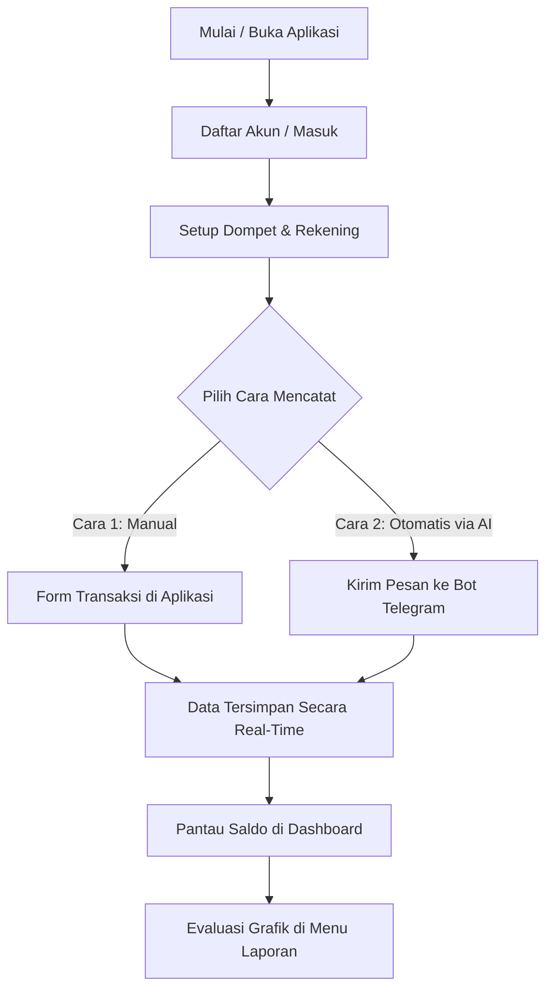

# 📱 Panduan Pengguna: Cashflow Tracker

Selamat datang di **Cashflow Tracker** — aplikasi pencatatan dan pengelolaan keuangan pribadi modern yang dirancang untuk membantu Anda memantau arus kas, mengendalikan pengeluaran, dan mencapai target finansial dengan mudah, cepat, dan cerdas.

Aplikasi ini dapat diakses melalui **Aplikasi Android**, **Web / PWA (iPhone, iPad, & Laptop)**, serta terhubung langsung dengan **Bot Telegram berbasis AI**.

---

## 🌟 Mengapa Menggunakan Cashflow Tracker?

1. **Pencatatan Super Cepat:** Catat pengeluaran hanya dengan mengetik pesan biasa di Telegram (contoh: *"Beli bensin 50rb"*), dan AI akan otomatis memahami serta mencatatnya.
2. **Multi-Dompet & Rekening:** Pisahkan saldo uang tunai, rekening bank (BCA, Mandiri, dll.), dan e-wallet (GoPay, OVO, ShopeePay) dalam satu aplikasi.
3. **Visual & Nyaman di Mata:** Dilengkapi dashboard visual modern bernuansa gradien hangat yang dirancang dengan kontras warna ideal agar mudah dibaca kapan saja.
4. **Laporan & Analisis Otomatis:** Ketahui ke mana uang Anda pergi setiap bulannya melalui grafik distribusi pengeluaran interaktif.
5. **Aman & Privat:** Akun Anda dilindungi dengan enkripsi standar industri dan akses berbasis autentikasi akun pribadi.

---

## 🗺️ Alur Penggunaan Aplikasi (User Journey)



### 1. Registrasi & Masuk Akun
- Pengguna baru cukup mendaftar dengan **Nama Lengkap**, **Email**, dan **Password**.
- Setelah masuk, sesi Anda akan tersimpan dengan aman sehingga Anda tidak perlu login berulang kali.

### 2. Atur Dompet & Rekening Keuangan
- Masuk ke menu **Pengaturan > Kelola Akun & Dompet**.
- Masukkan rekening atau dompet yang Anda miliki beserta saldo awalnya, misalnya:
  - *Dompet Tunai* (Cash): Rp200.000
  - *Rekening Utama* (Bank BCA): Rp5.000.000
  - *GoPay / OVO* (E-Wallet): Rp150.000

### 3. Hubungkan ke Telegram Bot (Opsional tapi Sangat Disarankan)
- Buka menu **Pengaturan > Hubungkan Telegram Bot**.
- Tekan tombol **Dapatkan Kode Tautan** (akan muncul kode seperti `PFT-1234`).
- Buka aplikasi Telegram, cari bot pencatat keuangan, lalu kirimkan perintah:
  ```text
  /link PFT-1234
  ```
- Akun Telegram Anda seketika terhubung dan siap digunakan untuk mencatat pengeluaran harian lewat chat.

---

## ⚡ Fitur-Fitur Utama

### 1. 📊 Dashboard Finansial Pintar
Dashboard adalah pusat kendali finansial harian Anda:
- **Total Saldo Terkonsolidasi:** Menampilkan akumulasi seluruh saldo dari seluruh rekening dan dompet Anda.
- **Kartu Ringkasan Bulanan:** Indikator total pemasukan dan pengeluaran pada bulan berjalan.
- **Slider Dompet:** Melihat saldo per rekening secara horizontal dengan sekali geser.
- **Daftar Transaksi Terkini:** Menampilkan aktivitas keuangan terbaru dengan tag kategori dan tanggal yang jelas.

---

### 2. 💳 Pencatatan Transaksi
Anda memiliki dua opsi fleksibel untuk mencatat transaksi:

#### A. Melalui Aplikasi (Mobile / Web)
- Tekan tombol melayang **`+ Catat Transaksi`**.
- Pilih jenis transaksi: **Pengeluaran** atau **Pemasukan**.
- Masukkan nominal transaksi, deskripsi, tanggal, rekening sumber, dan kategorinya.
- Transaksi langsung tersimpan dan otomatis mengupdate saldo akun terkait.

#### B. Melalui Chat Telegram Bot (AI Smart Assistant)
Cukup ketik kalimat sehari-hari seolah sedang berkirim pesan ke teman:
| Pesan Anda di Telegram | Tindakan Otomatis oleh Sistem |
|:---|:---|
| *"Makan siang nasi padang 25rb"* | Mencatat **Pengeluaran Rp25.000** di kategori *Makanan & Minuman*. |
| *"Beli bensin pertalite 50.000"* | Mencatat **Pengeluaran Rp50.000** di kategori *Transportasi*. |
| *"Dapat transferan gaji 6 juta"* | Mencatat **Pemasukan Rp6.000.000** di kategori *Gaji*. |
| *"Beli kopi kenangan"* | Bot akan merespons: *"Berapa nominal untuk pembelian kopi kenangan?"* |

**Perintah Cepat Telegram:**
- `/laporan` — Rekapitulasi keuangan bulan ini.
- `/laporan hari` — Laporan pemasukan & pengeluaran hari ini.
- `/laporan minggu` — Laporan minggu ini.
- `/laporan tahun` — Laporan sepanjang tahun ini.
- `/batal` — Membatalkan dan menghapus transaksi terakhir jika Anda salah mencatat.
- `/status` — Memeriksa profil akun yang sedang terhubung.

---

### 3. 📈 Laporan & Analitik Interaktif
Menu laporan dirancang untuk membantu Anda mengevaluasi kesehatan finansial:
- **Net Cashflow:** Melihat selisih bersih (*Pemasukan dikurangi Pengeluaran*). Jika bernilai positif (`+`), Anda mengalami surplus; jika negatif (`-`), pengeluaran Anda melebihi pemasukan.
- **Donut Chart Distribusi Pengeluaran:** Memvisualisasikan pos pengeluaran mana yang paling banyak menyerap anggaran Anda.
- **Rincian Persentase Kategori:** Setiap kategori dilengkapi bilah progres (*progress bar*) dan persentase belanja.
- **Pemilih Bulan:** Jelajahi riwayat keuangan bulan-bulan sebelumnya dengan menekan tombol navigasi bulan.

---

### 4. 🏷️ Kategori Fleksibel
- Sistem menyediakan kategori bawaan yang paling sering dibutuhkan (Makanan, Transportasi, Belanja, Tagihan, Hiburan, Gaji, dll.).
- Anda bebas menambahkan **kategori kustom baru** sesuai kebutuhan harian Anda melalui menu **Kelola Kategori**.

---

### 5. 🌐 Akses Multi-Platform
- **Android:** Dapat diinstal langsung sebagai aplikasi native berkecepatan tinggi.
- **iPhone / iOS (Safari PWA):** 
  1. Buka tautan web aplikasi di browser Safari iPhone.
  2. Tekan tombol **Share** (kotak dengan panah ke atas).
  3. Pilih **"Add to Home Screen"** (*Tambahkan ke Layar Utama*).
  4. Aplikasi akan tampil di homescreen tanpa bilah peramban (layaknya aplikasi native).
- **Komputer / Tablet:** Tampilan web responsif yang nyaman dibuka melalui layar laptop maupun tablet.

---

## 🔒 Privasi & Keamanan Data Pengguna

- **Kata Sandi Terproteksi:** Seluruh kata sandi akun dienkripsi secara satu arah (*salted hashing*). Pihak manapun tidak dapat melihat password asli Anda.
- **Koneksi Terenkripsi (HTTPS):** Seluruh lalu lintas data antara perangkat Anda, server cloud, dan Telegram berjalan melalui kanal aman bersertifikat SSL/TLS.
- **Pemisahan Data Akun:** Setiap pengguna memiliki ruang data pribadi yang terisolasi; pengguna lain tidak dapat melihat saldo maupun catatan transaksi Anda.

---

## 💡 Tips Finansial Menggunakan Aplikasi Ini

1. **Jadikan Kebiasaan Setelah Transaksi:** Buka Telegram langsung setelah membayar sesuatu di kasir atau menyelesaikan transfer online, ketik nominalnya dalam 3 detik.
2. **Evaluasi Setiap Akhir Pekan:** Luangkan waktu 2 menit di menu **Laporan** setiap hari Minggu untuk melihat kategori mana yang anggarannya mulai menipis.
3. **Gunakan Fitur `/batal` Jika Salah:** Jika salah mengetik angka di Telegram, segera ketik `/batal` untuk membatalkan catatan terakhir tanpa perlu membuka menu edit.

---

*Panduan Pengguna — Cashflow Tracker v1.0.0*
